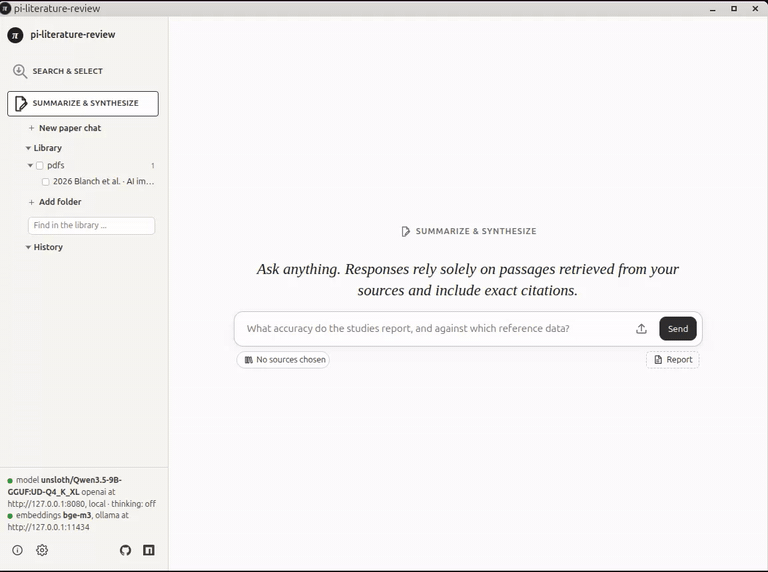

<p align="center"><picture><source media="(prefers-color-scheme: dark)" srcset="https://raw.githubusercontent.com/flindenberger/pi-literature-review/main/docs/img/logo-dark.png"></picture></p>

<p align="center"><i>Search the literature. Select the papers. Summarize and synthesize.<br>Streamlined for local AI models.</i></p>

<p align="center"><a href="https://www.npmjs.com/package/pi-literature-review"></a> <a href="https://github.com/flindenberger/pi-literature-review/actions/workflows/test.yml"></a> <a href="LICENSE"></a> <a href="https://doi.org/10.5281/zenodo.22954995"></a></p>

<p align="center"><a href="https://flindenberger.github.io/pi-literature-review/"><picture><source media="(prefers-color-scheme: dark)" srcset="https://raw.githubusercontent.com/flindenberger/pi-literature-review/main/docs/img/try-it-dark.png"></picture></a></p>

<p align="center"><a href="#as-pi-coding-agent-extension"></a>&nbsp;&nbsp;<a href="#as-standalone"></a></p>

&nbsp;

A local, open, login-free literature tool as an extension for the [Pi coding agent](https://pi.dev) or as a standalone browser app: search four academic paper databases plus code repositories, explore citation graphs and PRISMA diagrams, then ask your PDFs and get answers with page-exact citations, optimised for your local AI models.

&nbsp;

<p align="center"></p>

&nbsp;

## Features

- **Search papers and download them directly** — arXiv, CrossRef, OpenAlex and Semantic Scholar, verified DOIs, open-access PDFs into a folder you choose
- **Search papers with code repositories** — code and data links on every result, plus papers found through GitHub, Hugging Face and awesome lists
- **Search for specific authors and their work** — narrow a topic to chosen authors, or list everything they published, optionally as first author
- **Ask questions and write summaries or synthesis reports about your PDF library** — page-exact citations, highlighted where they come from
- **Drag and drop your PDFs** — straight into the browser and start asking
- **Optimised for local AI models** — tested with 8–9B models on an 8 GB graphics card; search needs no model at all
- **Citation graphs** — see what a paper builds on and who cites it
- **PRISMA diagrams** — a reproducible search record, from query to final list
- **No language model ever touches paper data** — titles, authors, DOIs, abstracts and citations come from the source APIs, checked and inserted by fixed code

## Install

### As Pi coding agent extension

```sh
pi install npm:pi-literature-review
```

In Pi, call `/pi-literature-review` for the browser interface. For the terminal version, call `/lit-search` or `/lit-synthesis`.

### As standalone

To use the standalone version in your browser, run:

```sh
npx pi-literature-review web
```

Needs Node.js 22.19 or newer. Searching needs no model. Chat and reports use the model selected in Pi, or Ollama, llama.cpp or any OpenAI-compatible server, plus a small embedding model the package fetches for you — see [Requirements](docs/requirements.md).

## Privacy

No account, no telemetry. Search terms and paper identifiers go to the public scholarly APIs. PDF text goes only to your own embedding and chat models; with a remote model, excerpts go to that provider.

## Documentation

[Requirements](docs/requirements.md) · [Search & selection](docs/search.md) · [Summary & synthesis](docs/synthesis.md) · [Browser](docs/web.md) · [Configuration](docs/configuration.md) · [Command line](docs/cli.md) · [Development](docs/development.md)

## How to cite

If the package supports your work, please cite it:

> Lindenberger, F. (2026). *pi-literature-review* (Version 0.2.0) [Computer software]. Zenodo. https://doi.org/10.5281/zenodo.22954995

The DOI always resolves to the latest version. BibTeX and other formats: [`CITATION.cff`](CITATION.cff) or "Cite this repository" in the sidebar of this page.

## Contributing

Questions, bug reports and pull requests are welcome — open an [issue](https://github.com/flindenberger/pi-literature-review/issues); [CONTRIBUTING.md](CONTRIBUTING.md) says what helps. Please report security problems privately, as described in [SECURITY.md](SECURITY.md).

## About

Developed in the research project *Satellite Remote Sensing and Field Data Fusion for Hydraulic Engineering* ([BAW](https://www.baw.de), [UPC](https://www.upc.edu/ca), [TU Dresden](https://tu-dresden.de/?set_language=en)). The multi-source search was inspired by [paper-search-mcp](https://github.com/openags/paper-search-mcp) (MIT). The synthesis stage can use [OpenScholar-8B](https://github.com/akariasai/openscholar) (Asai et al., 2024, [arXiv:2411.14199](https://arxiv.org/abs/2411.14199)) as its writing model; the package was first built around it.

**Use of AI.** Developed using Claude Code as a development tool (code, tests, documentation). The maintainer made the design decisions and tested the changes.

**License.** MIT — see [LICENSE](LICENSE).
