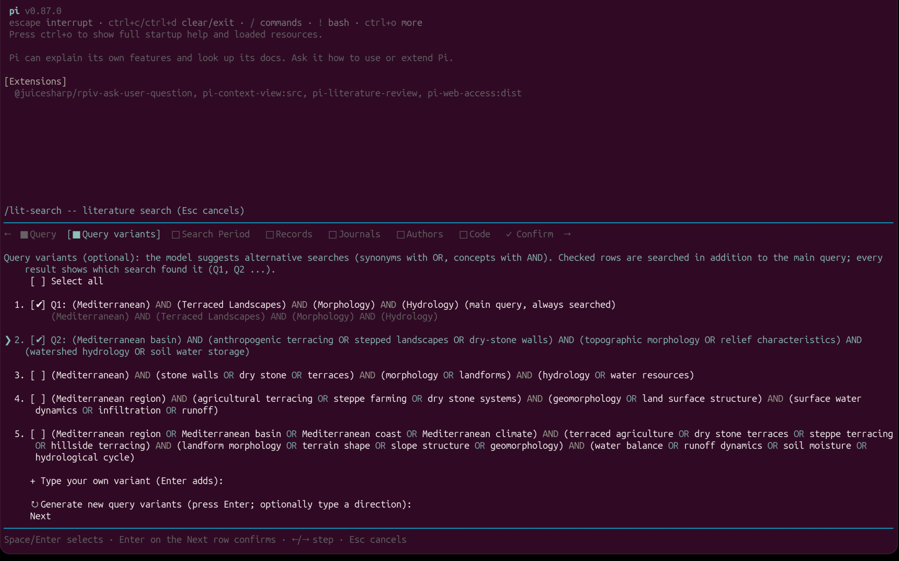
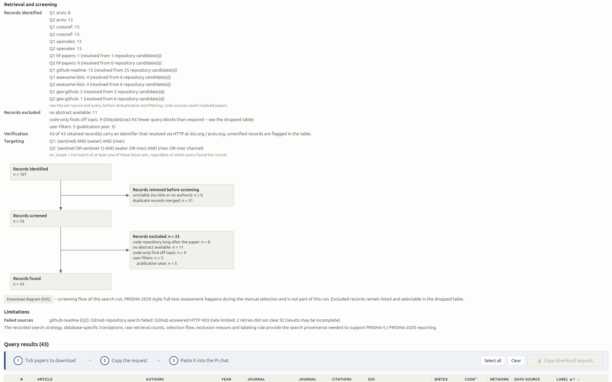
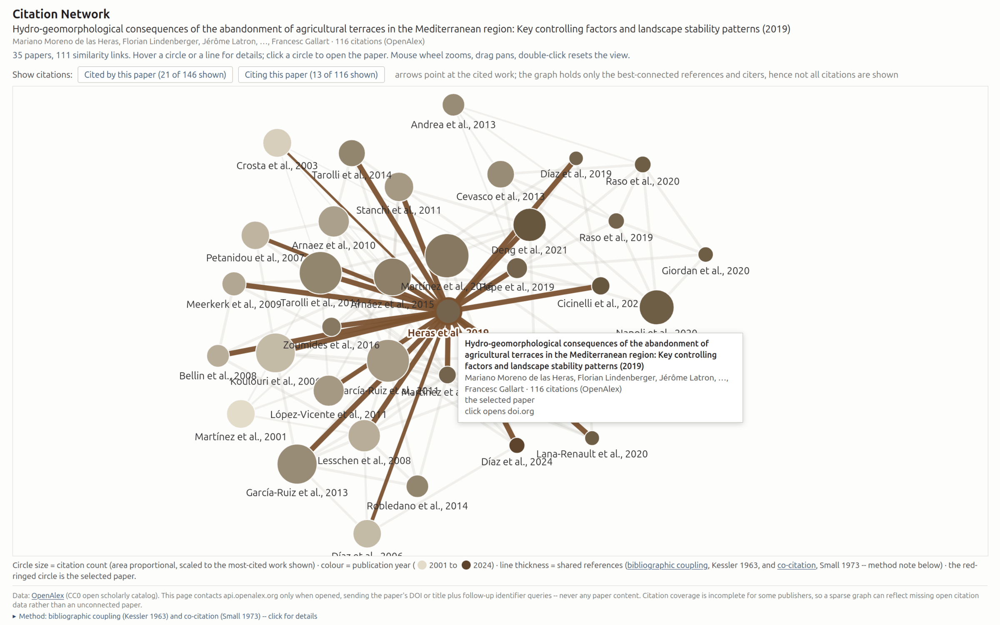

# Search (`/lit-search`)

First part of the stage "Search & select". Searches the open scholarly APIs and writes a results page. A model may shape the queries; every record shown comes from an API response.

## Sources

| Source | Receives | Key |
|---|---|---|
| arXiv | Concept blocks as a boolean query | None. Not queried in the browser live demo (arXiv answers no requests from web pages). |
| CrossRef | Flat relevance keywords (no boolean syntax) | None |
| OpenAlex | Concept blocks as a boolean query | Optional `openAlexApiKey` |
| Semantic Scholar | Concept blocks as a bulk boolean query, sorted by citation count (disclosed on the results page) | `s2ApiKey` required. Without it: not queried, noted on the Sources row. |

- **Record types:** CrossRef and OpenAlex requests filter for scholarly works. Peer-review reports, author replies, datasets and supplementary material are excluded. The "Sent to" rows of the results page show the filter.
- **OpenAlex key:** sent as an `Authorization` header, never in a URL. Without a key, OpenAlex draws on one daily credit budget shared by every machine behind the same IP address; the results page notes this on the Sources row. An invalid key fails with HTTP 401 and the error names the setting.
- **Contact email:** see [Selection -> Contact email](selection.md#contact-email).
- Keys: [Configuration](configuration.md#keys-and-contact-data).

## The wizard

- `/lit-search` and every interactive tool call open a tabbed dialog before any request. Agent parameters only prefill it.
- Esc cancels without a network request. An empty query at submit cancels.
- The settings shown at submit are exactly the settings that run.
- Dialog language follows the chat: English or German.

| Tab | Content |
|---|---|
| Query | Keyword-block form: one concept per field, synonyms separated by OR or commas, AND between fields. 5 fields shown, up to 8 via "Add keyword block". A free-text field below takes a sentence or own query syntax; when filled it becomes the query (warning when both are filled). |
| Query variants | Model-suggested alternative searches, see below |
| Search period | Last 5, 10 or 20 years, all years, or a custom range (`2015-2024`). Bare call: last 5 years; agent proposal: all years unless it names a range. |
| Records | Per source: 5 (default), 15, 50 (cap), or custom. Optional "Min. citations per paper"; records below it go to the dropped table. |
| Journals | OpenAlex journal list, see below |
| Authors | OpenAlex author list and author lookup, see below |
| Code | Code-first sources, see below |

### Query variants

One call to the LLM suggests three alternative searches as concept-block boolean queries, in the base query's concept order.

| Row | Rule |
|---|---|
| +1 synonym per block | Base terms plus at most one synonym per block |
| +2 synonyms per block | Base terms plus at most two synonyms per block |
| optimized for arXiv | Method words instead of field jargon, at most three terms per block |

- Limits are enforced in code: longer blocks are cut; the base terms, including your own synonyms, always stay.
- Missing arXiv row: one follow-up call; if still missing, a note on the main row.
- Hand-built block expression as base: the first two rows keep its blocks and vary only the synonyms.
- Base query reads like a sentence: the first suggestion distills it into concept blocks and arrives checked.
- The main query is locked and always runs. Every checked row runs as an additional query in the same run.
- **Add row:** a variant you type yourself. **Steering row:** a direction; Enter regenerates the three rows, checked rows stay.
- No model selected: only the main query.

### Journals

- The 12 most frequent journals OpenAlex holds for the query and period (title and abstract only), with hit counts and the 2-year citedness, plus "Other journals/sources".
- Exclusion list: all rows arrive checked, unticking excludes, all or none checked = no filter. Removals survive a reload.
- An agent `venues` proposal arrives as a checked whitelist.
- Picked journals match whole names (case, spacing, punctuation and "&"/"and" ignored). `venues` passed without the picker match as substrings.

### Authors

**List: authors with the most works on this query.**

- The 12 authors with the most OpenAlex works on the query, period and journals (title and abstract only), ordered by that count. Career citations, h-index and topics as context. Plus "Other authors".
- Exclusion list, same rules as the journals. With "Other authors" unticked, the remaining names also go into the source queries.
- Greyed out once an author is picked below.

**Lookup: limit the search to a specific author.**

- Typing row: OpenAlex lookup from 3 letters, 400 ms after the last keystroke. Matches show institution, works, citations, h-index and topics.
- Ticking a match picks the person; several picked authors are OR-ed.
- Position boxes "as first author" / "as contributing author": both ticked = any position.
- "all publications of this author, ignoring the search query": OpenAlex by author ID (citation-sorted), CrossRef and arXiv by name, Semantic Scholar skipped (noted under "Failed sources"). The blocks then only label.

**Matching.** OpenAlex filters by author ID; CrossRef and arXiv get the name in their author field. A post-filter over the author names is the guarantee: a name matches by substring or by surname plus first initial, accents ignored ("Carl Legleiter" = "Carl J. Legleiter" = "Legleiter, C."). Records without a picked author go to the dropped table with the reason. The results page carries an "Author scope" row, the JSON `author_scope`.

### Code

Four code-first sources, off by default. The head row "Search and add papers with Code" ticks or clears all. No key needed. Together up to about 40 s per run.

| Source | Finds |
|---|---|
| Hugging Face Papers | arXiv papers with the repository linked on their Hugging Face page |
| GitHub README search | Repositories whose README cites an arXiv paper |
| Awesome lists (awesome.ecosyste.ms) | Awesome lists found by GitHub topic; entries matched against the blocks |
| Google Earth Engine (GitHub) | Repositories for the Earth Engine code editor whose README cites a DOI |

- Repositories are searched first; the papers they cite are resolved at arXiv or OpenAlex.
- **Date gate:** repository created more than a year after its paper: dropped table. More than five years: not listed.
- **Overview pages:** the linked repository whose name matches the paper title is taken.
- **Topic gate:** a paper found only by code sources must fit the query: title and abstract hit every block (1-2 blocks) or all but one (3 or more) of at least one confirmed query. Otherwise dropped table.
- **Awesome-list topics:** ticking the source shows topic rows: the configured `codeListTopics` (default `remote-sensing`, `satellite-imagery`, `earth-observation`) and up to 5 model suggestions, each with its list count from awesome.ecosyste.ms (suggestions with 0 lists are hidden). An own topic can be added.
- Without code sources, code and data links still come from the abstract and the DOI registries (see [Pipeline](#pipeline), step 10).

## Author-only search

An empty request with picked authors and the scope "all their work" lists their works without a query.

- All years, up to 200 records per source (`MAX_AUTHOR_WORKS_PER_SOURCE`, instead of 50)
- Abstract gate off: works without an abstract stay in the results
- Optional "first author" choice
- Browser only ([Browser interface](web.md#author-only-search)). The terminal wizard cancels an empty query, the tool caps `per_source` at 50, the CLI requires a query.

## Block search

The concept blocks of every confirmed query:

- **drive the search:** boolean queries for arXiv, OpenAlex and Semantic Scholar; keywords for CrossRef.
- **label the records:** `on_target` when title and abstract fully match the blocks of ANY confirmed query, else `adjacent`. Each on-target row names the query and the matching term per block ("via Q2: river channel · water surface · satellite").
- **Matching:** whole words, tolerant of hyphen/space, plural -s and consonant+y to -ies. No stemming, no further synonyms.

## Pipeline

Fixed code, no model:

1. **Fetch:** all sources in parallel, the queries of one source in turn. Raw counts per source and query. Code-first sources count as "other methods".
2. **Junk filter:** no title or no authors.
3. **Deduplication** by DOI or arXiv ID, across sources and queries.
4. **Late code pairs** (date gate) to the dropped table.
5. **Verification** over HTTP: doi.org (6 in parallel), arxiv.org (one at a time).
6. **Enrichment** via batched OpenAlex lookups: missing citation counts, journal names, journal 2-year citedness, abstracts. Missing abstracts from Semantic Scholar by DOI only with `s2ApiKey`, marked `*`.
7. **Abstract gate:** no abstract, dropped table (off for author-only search).
8. **Topic gate** for code-only finds.
9. **Filters** (period, citations, journal score, journals, authors, PDF, verified), optional sort, then **labeling**.
10. **Links and access**, for both tables:
    - code link named in the abstract (GitHub, GitLab, Bitbucket, Codeberg, Hugging Face, Zenodo, OSF);
    - data links from the DOI registry record to a known archive (Zenodo, PANGAEA, Mendeley Data, Dryad, figshare, Dataverse, HydroShare, OSF, Eawag, GitHub, GitLab): CrossRef relations `is-supplemented-by`, `is-part-of`, `references` (100 DOIs per request, started right after deduplication); DOIs CrossRef does not hold go to DataCite (`IsSupplementTo`, `IsSupplementedBy`, `References`; 25 DOIs per request);
    - access status from OpenAlex by DOI (50 DOIs per request): `access` (`level`, `oa_status`, `pdf_urls`, `work_type`, `source_type`) and `access_counts` in the JSON.

Every removed record stays in the dropped table with its reason. A failed source is listed while the run continues.

## Download: the second part of the stage

After the results card, `/lit-search` asks **Which papers do you want as PDFs?** in the place of the input box. Command only; a tool call returns the digest.

| Answer | Selects |
|---|---|
| `Download these papers: ...` | The line copied on the results page |
| `1 3 7` | Row numbers of the results table |
| DOIs or arXiv IDs | These papers |
| `all` | Every on-target paper not yet in your library |
| `code` | Every paper with a code or data link, not yet in your library |
| Empty or Esc | Later; `/lit-selection` takes the same input any time |

- An answer that names no paper, or selects none, is asked again.
- A pick runs the selection steps: Unpaywall email while none is configured, download folder, consent ([Selection](selection.md)).
- The per-paper report shows as a widget, papers to open in the browser first.
- The agent's short summary comes once, after this question, covering search and download.

## Results page

- `lit-search/<date>_<query>.html` in the store, plus a JSON sidecar with the same base name. Store location: [Configuration -> Where files live](configuration.md#where-files-live).
- Self-contained, readable offline. Generated from the JSON by fixed code.

| Part | Content |
|---|---|
| Tables | *Query results* and *Dropped records*, same columns. Multi-level click sorting, expandable abstracts, folded author lists. Per row a **BibTeX** button (entry built from the record fields) and a **Graph** button. |
| Sources row | Sources used, skipped sources with the reason, the OpenAlex budget note without a key |
| Search documentation (collapsed) | Expression sent to each source per query, raw counts per source and query, the selection flow, verification and link counts, labeling rule. Material for PRISMA 2020 and PRISMA-S reporting. |
| PRISMA flow diagram | Inside the search documentation, drawn from the run's counts: phase bands Identification, Screening, Included; boxes "Records identified", "Records removed before screening", "Records screened", "Records excluded" (with reasons), "Records found". "Download diagram (SVG)" link. |
| Code / data column | Only when a record carries a link: code repository by host, then each data archive by name |
| Access marker | In the DOI column, see below |
| Download steps | Sticky strip above the results table, see below |

- **Provenance in the JSON:** `enriched.code_url` = `abstract` or the code-first source; `enriched.data_links` = `crossref` or `datacite`. Links in `code_url` and `data_links`.
- The agent receives only a short digest (counts, HTML path, one reference line per record), never the JSON.

### Access marker

From the OpenAlex open-access status; the exact category in the tooltip.

| Marker | Rule |
|---|---|
| `full text free` | Open access (gold, diamond, hybrid, green, bronze); arXiv records always |
| `abstract only` | OpenAlex type `conference-abstract`: no paper PDF exists |
| `restricted` | Not open access; often reachable in the browser, e.g. in a university network |
| `unknown` | No DOI, or OpenAlex does not list it |

- **PDF link:** the first open PDF location from OpenAlex, else the source's link. None for restricted rows and image files.
- The *Access* row above the tables sums the markers. Every row stays tickable.

### Download steps

1. Tick rows in either table.
2. **Copy download request.**
3. Paste `Download these papers: <id>, ...` into Pi: the open download question of `/lit-search`, later `/lit-selection` or the chat.

- Step markers fill as each step is done.
- A note under the steps counts ticked rows that are restricted or abstract only.

### Citation graph

`network.html`, next to the results page, opened by a row's **Graph** button.

- The paper's references and citing works from OpenAlex, fetched on opening. Only the DOI or title is sent; no model.
- Up to 35 works (the paper plus 34 best-connected), circle area = citations, colour = year, lines = bibliographic coupling and co-citation.
- Cited works to the left, citing works to the right. Toggles "Cited by this paper" / "Citing this paper" draw direct citations as arrows.
- Hover focuses a node or names a line's reason. Wheel zooms, drag pans, double-click resets.
- Browser interface: light view (`#...&light=1`), explanations behind a **Legend** button.

## Tool parameters

Tool `pi-literature-search`. In interactive calls every parameter only prefills the wizard.

| Parameter | Meaning |
|---|---|
| `query` | Search query (required) |
| `query_variants` | Additional queries for the same need, run together |
| `group_terms` | Concept blocks of the base query; drive search and labeling |
| `per_source` | Records per source. Default 5, maximum 50. |
| `sources` | Subset of `arxiv`, `crossref`, `openalex`, `semanticscholar` |
| `code_sources` | Any of `hf-papers`, `github-readme`, `awesome-lists`, `gee-github`. Default none. |
| `code_list_topics` | GitHub topics for the awesome-lists source (fields, not query words) |
| `min_cites`, `min_journal_score` | Minimum citations; minimum journal 2-year citedness |
| `year_from`, `year_to` | Publication year range |
| `venues` | Journal names, substring match |
| `authors`, `author_ids` | Author names; OpenAlex author IDs alongside (headless) |
| `author_position` | `first`, `contributing` or `any` |
| `author_scope` | `query` (author AND query) or `all` |
| `require_pdf`, `verified_only` | Keep only records with a PDF link / a verified identifier |
| `sort` | `cites` or `year` |
| `enrich` | Enrichment, links and access. Default on. |
| `html_file` | Output path override |

Command line: [CLI -> Search](cli.md#search). Code: [Development -> Module map](development.md#module-map).
