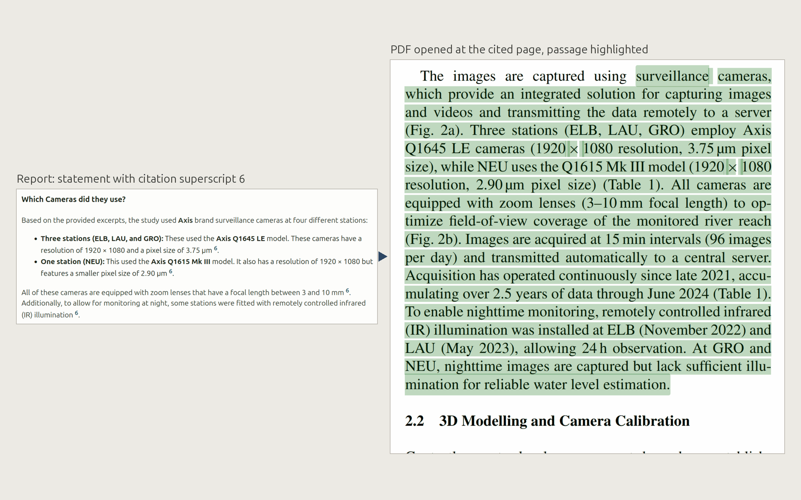

# Synthesis (`/lit-synthesis`)

Grounded chat and reports over the local PDF library, with page-exact
citations that open the PDF at the cited passage.

## First call

The first `/lit-synthesis` checks for the local embedding model and, if it
is missing, offers to fetch it (Ollama, one-time, stays on your machine).
If no backend is reachable it names the options instead -- see
[Requirements](requirements.md). For the default setup there is nothing to
configure.

## Corpus and index

The corpus is every PDF in your PDF folders (recursively), the PDFs
dropped onto the browser page (`inbox/` in the store), an older
`lit-selection/` library and loose PDFs in the working directory (see
[configuration.md](configuration.md#where-files-live)). On duplicate file
names the earlier source wins and the shadowed files are reported. A loose PDF is adopted when its own DOI or arXiv ID can be
extracted from the text and verified; otherwise it is cited by filename
and page.

Each PDF is indexed once under the store's `lit-synthesis/index/`: text extraction
(scanned PDFs are excluded and named), reference list cut off, roughly
1000-character chunks, embeddings. The index is invalidated by a change of
content hash, embedding model or chunking.

## Trust architecture

The generator sees only NUMBERED text excerpts and may cite only by
excerpt number. Fixed code validates every marker, strips fabricated ones
-- reported, not hidden -- and inserts the references from the verified
records. An answer without a valid citation is flagged `grounded: false`
with a warning.

Retrieval is the question plus a disclosed English translation variant
plus a deterministic lexical layer (salient words, whole-word matched),
returning the top 8 excerpts. Over a chosen set of papers (not the whole
library) every paper is guaranteed its two best excerpts (fewer when the
set is large, none once it has more papers than excerpts), the rest go by
score -- otherwise one well-matching paper can fill all eight places and
the answer hears from it alone. The same holds for the cross-paper
questions of a report over chosen papers. The generator has no chat memory of its own;
the Pi conversation carries the thread.

## Scope

One paper, a selection, or the whole library. You pick it in the wizard
(checkbox list, select-all = library), or the agent passes exact
filenames -- unknown names are rejected with the real list.

The scope is sticky within one Pi session and survives `/resume`; a new
session starts blank. With an empty library the tool is deactivated.

## Chat mode

One grounded answer per question, with page-exact references
(`[1] 2026 | 10.5194/... | Title (p. 4)`) on a card that shows the
question exactly as it ran and carries `file://...pdf#page=N` links. The
agent adds only a brief answer in the chat; the card is the ground truth.

Every grounded round arms **paper-chat mode** (yellow hint line): plain
inputs then run directly as questions, with no agent in the answer path.
`exit` leaves it. Rounds are appended to a protocol file under
`lit-synthesis/protocols/`.

## Report mode (`/lit-synthesis` only)

Reports cost many model calls, so the wizard is the consent: a
report-flavoured chat request is handed back to `/lit-synthesis`, with the
questions tab prefilled from the session's chat questions.

Three building blocks:

- per-paper structured summaries along a fixed rubric -- goal, method,
  site, results, discussion, outlook
- detail questions, answered per paper or merged across the scope
- an optional review synthesis (several documents only)

The HTML report is named after its papers:
`lit-synthesis/<date>_synthesis_report_<first authors>.html`, e.g.
`2026-09-18_synthesis_report_Li_Moortgat_Chen.html` -- up to three first
authors in scope order, `_et_al` when more papers follow (with no author
data the scope label is used).

The page follows the chat language and carries a collapsed technical
block that explains the retrieval in plain language. Every cited passage
gets one number, and that number is what the superscripts show: one
number stands for one page and one excerpt, never for a paper (a paper
number would repeat on every marker of that paper's summary). The
numbering runs paper by paper in scope order, so every paper owns one
contiguous range -- citation order would scatter a paper's numbers over
the whole report, because the cross-paper and review sections cite all
papers again at the end. Several passages cited at the same spot share
ONE superscript and are separated by commas (`1, 6, 26`), ascending, each
number with its own page link. Each paper's block lists its cited
passages with page link, excerpt and the retrieval rank per citing
question; cross-paper sections name the paper on every passage line and
add a paper-level reference table.

### Highlighted passages



Citation superscripts open the PDF at the page and highlight the WHOLE
cited passage. At index time the code measures how much of each chunk the
PDF viewer can actually find -- `src/pdfjs-find.ts` reproduces pdf.js's
own text matching -- and offers only that much. In Firefox 90-99 % of
excerpts highlight in full; Chromium opens the page but ignores the
passage search.

### HTML-write gate

While a document scope is active, an agent write of an `.html` file opens
a dialog offering the report wizard instead. "Allow" lets an unrelated
file through.

## Models

Answers, summaries and reviews run on the model selected in Pi.
Optionally `llm.generateModel` routes the review genres to a dedicated
model, for example [OpenScholar-8B](https://github.com/akariasai/openscholar) (Asai et al., 2024, [arXiv:2411.14199](https://arxiv.org/abs/2411.14199)) as a GGUF imported
into Ollama; the report names the model that ran. Embeddings always run on the embedding backend
-- see [Configuration](configuration.md).

### Thinking

Every model call of this package follows the package's own thinking
settings (config.json or Settings in the browser), one per role: the
LLM role (answers, summaries, per-paper report units, the English
retrieval variant, the query-variant suggestions, the browser's keyword
blocks, help answers and small-talk check) follows `thinking`; the
generation role (the cross-paper synthesis and review units of a report)
follows `generateThinking`, unset = the same as `thinking`. Each is
**off** by default, or low / medium / high.
It is independent of pi's thinking level, read anew for each call, and
works the same inside pi and standalone. When on, every call gets extra
output room for the hidden reasoning (2k / 4k / 8k tokens).

<details>
<summary>What to expect, and what llama.cpp needs</summary>

Thinking makes every call slower; on a small local model it rarely helps,
because the calls are excerpt-bound (answer only from the numbered
excerpts, cite by number). Citations stay code-checked either way. A
thinking model may still spend a call's whole budget on reasoning and
return no answer text; the error then says so ("it produced only hidden
reasoning") -- turn Thinking off or lower, or ask again. Short checks
with a time limit (small talk, help) fall back as without a model:
the message is looked up in the papers, the fixed help text is shown.

One prerequisite for llama.cpp served through Pi: the model must be
registered in Pi WITH metadata -- a `models.json` provider carrying
`compat.thinkingFormat`, e.g. `qwen-chat-template`. The quick form
`provider=URL` registers it without, and thinking then cannot be switched
by any client.

</details>

## Command line

```
node src/cli.ts synthesis "Which cameras were used?" --paper 2026_Blanch_Water_Level.pdf --digest
node src/cli.ts synthesis --report --papers "a.pdf,b.pdf" --questions "q1;q2" --summary bullets
node src/cli.ts synthesis --report --all --review
```

See [Command line](cli.md).

Where it lives in the code: see [Development -> Module map](development.md#module-map).
